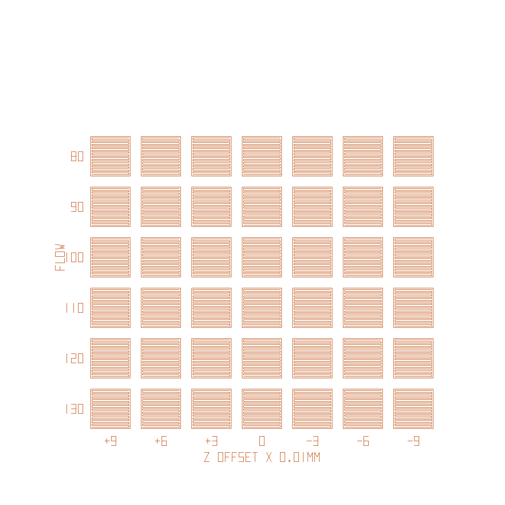
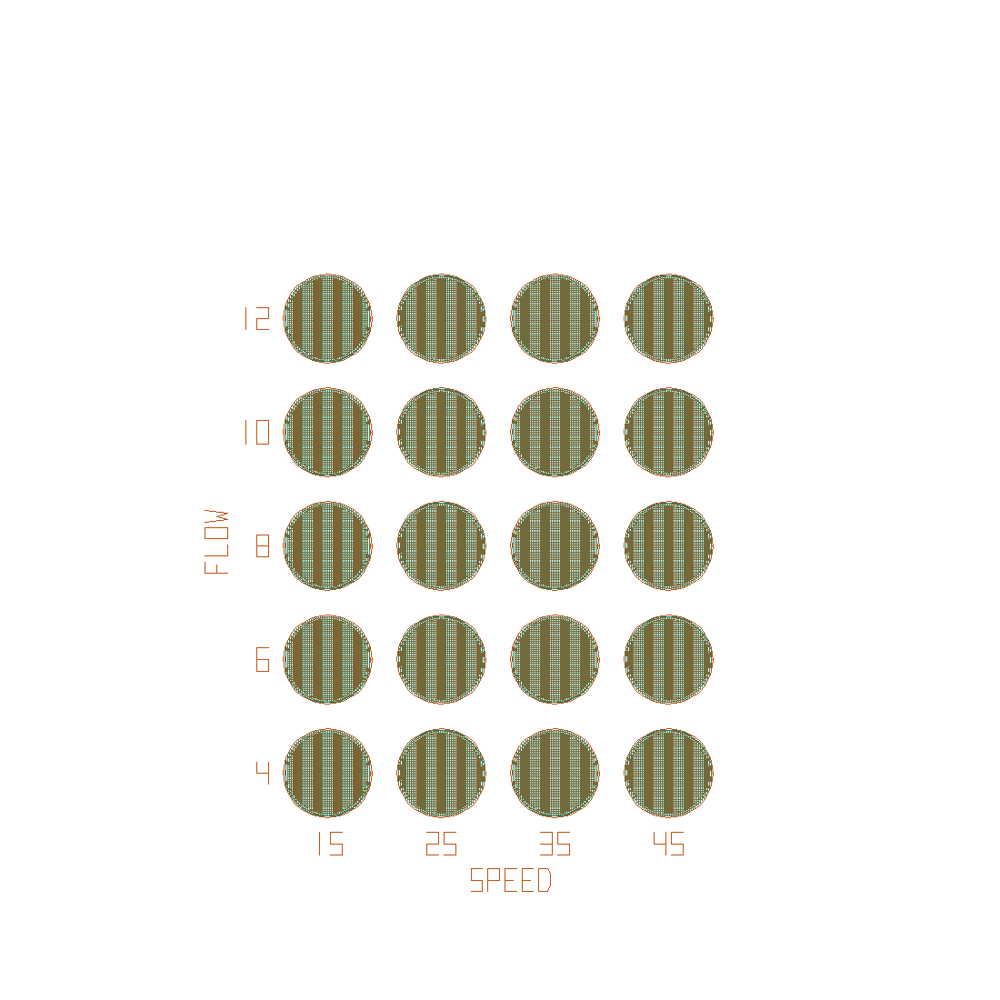
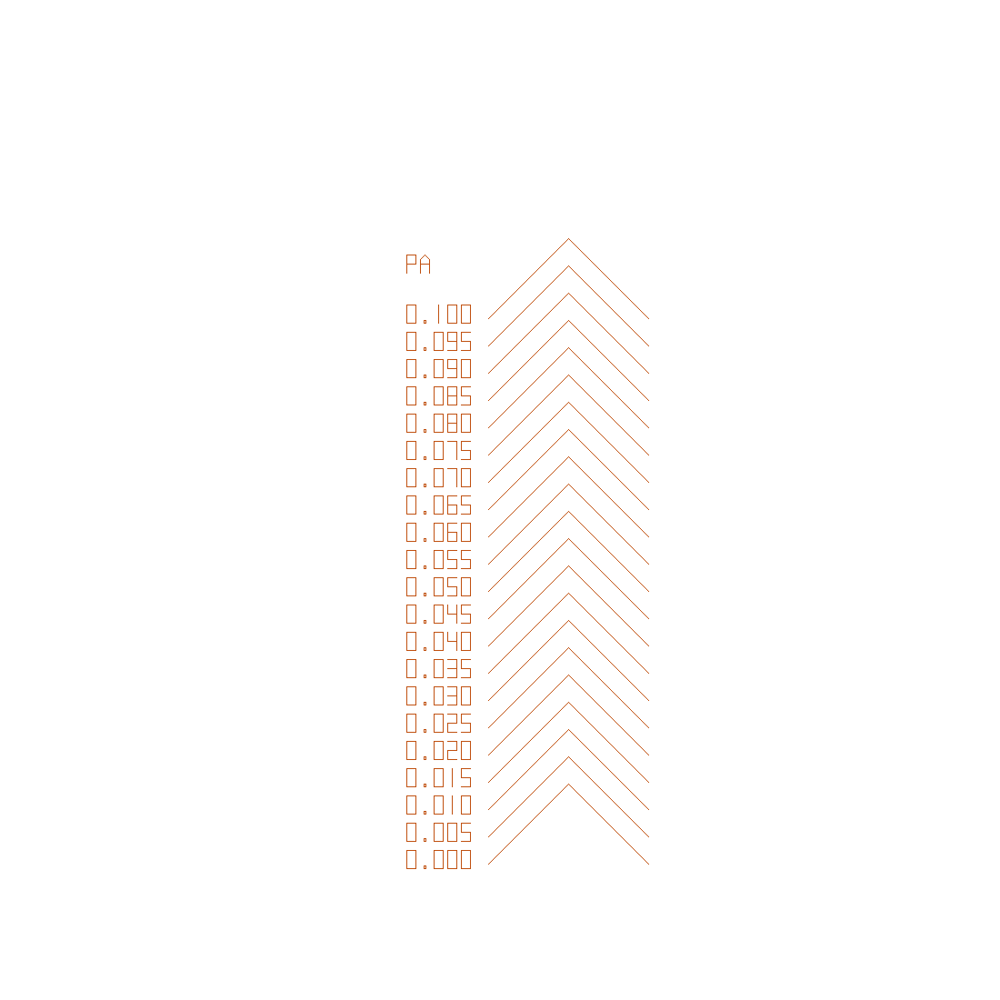
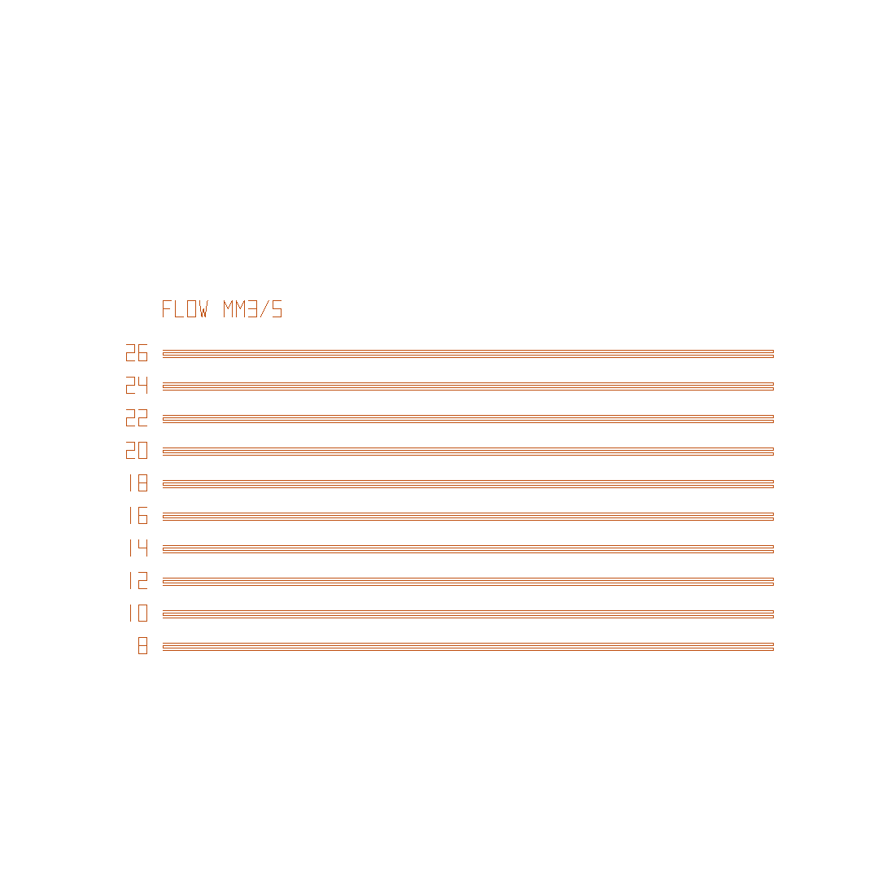

# Klipper calibration grids

Four small Python scripts that write ready-to-print G-code calibration tests
for Klipper printers. No slicer involved: each script generates every move
directly, so one file tests a whole grid of settings in a single print.

Written for a Sovol SV07 (220 x 220 bed, 0.4 mm nozzle, PLA) running Klipper,
but every dimension, temperature and speed is a constant at the top of each
script.

| Script | What it tests | Output |
|---|---|---|
| `make_first_layer_grid.py` | Nozzle height (Z offset) across, first-layer flow down | `first_layer_grid.gcode` |
| `make_ironing_grid.py` | Ironing speed across, ironing flow down | `ironing_grid.gcode` |
| `make_pressure_advance.py` | Pressure advance, one corner pattern per value | `pressure_advance.gcode` |
| `make_max_flow.py` | Hotend maximum volumetric flow, one band per mm³/s rate | `max_flow.gcode` |
| `render_preview.py` | Draws the `.png` previews from any of the `.gcode` files | `*.png` |

The included `.gcode` files are the output of the scripts as committed, and the
`.png` files are top-down previews of the toolpaths.

## First layer grid



A grid of single-layer 18 mm squares. Each column is printed at a different
nozzle height relative to your current probe `z_offset` (labelled in 0.01 mm
units, so `+9` is 0.09 mm higher). Each row uses a different first-layer flow
percentage. Labels are printed on the bed next to the grid.

Pick the square that is smooth and matte, with the lines fused and no gaps or
ridges, and that lifts off as one sheet. Then:

- Flow row: set it as the slicer's first-layer flow (Cura: *Initial Layer Flow*).
- Z column: new `z_offset` = current `z_offset` **minus** the column value.
  A winning column of `-3` with a `z_offset` of 1.800 means 1.830.

If the winner sits on an edge of the grid, shift `Z_OFFSETS` or `FLOWS` in
that direction and run it again. If the same physical spot on the bed wins
regardless of its label, suspect the bed mesh or screw levelling in that
corner, not the setting. Mirroring the lists is a quick way to check.

## Ironing grid



A grid of discs with identical bases, each ironed with its column's speed and
its row's flow at a fixed line spacing. Compare under a lamp at a low angle.
Visible lines between passes mean too little flow or too wide a spacing;
a raised rim or shiny bumps at the edge mean too much flow. Take the fastest
speed that still matches its slower neighbours.

Cura equivalents: *Ironing Flow*, *Ironing Speed*, *Ironing Line Spacing*.

## Pressure advance pattern



One chevron per pressure advance value, 0.000 to 0.100 in 0.005 steps, each
labelled. Every leg starts slow, accelerates to the fast speed into a 90
degree corner, and slows again at the end, so the speed changes expose the
pressure advance error. Lines are four layers tall so they are easy to read.

- Too low: a blob at the corner and a thin stretch after the slow-to-fast change.
- Too high: a gap or very thin corner, and a bulge where the line slows down.
- Right: even width end to end, crisp corner.

Take the lowest value with a crisp corner and set it in `printer.cfg`:

```
[extruder]
pressure_advance: 0.035
pressure_advance_smooth_time: 0.040
```

The script restores your configured value at the end of the print, so the
test does not change the printer's live setting.

## Maximum flow test



One band per volumetric rate, 8 to 26 mm³/s front to back, each labelled.
A band is four adjacent 150 mm lines printed as one continuous serpentine,
two layers tall, so the hotend has to sustain the rate for several seconds.
Line width and height are fixed; only the speed changes.

Three ranges are included, so you can step up if every band in the first
one is good:

| File | Rates (mm³/s) | Speeds at 0.60 x 0.28 mm |
|---|---|---|
| `max_flow.gcode` | 8 to 26 | 48 to 155 mm/s |
| `max_flow_v2.gcode` | 14 to 32 | 83 to 190 mm/s |
| `max_flow_v3.gcode` | 28 to 46 | 167 to 274 mm/s |

Any other range without editing the script:

```
python make_max_flow.py 28 30 32 34 36 38 40 42 44 46 -o max_flow_v3.gcode
```

**Clean the bed first.** On a greasy PEI sheet the fast bands lift and curl
part way along and look exactly like a hotend that has run out of flow. On
an SV07 at 225 °C the 22 to 26 bands curled on a dirty bed, then every band
up to 32 printed solid after a wash.

- Good: even width end to end, both layers solid, matte surface.
- Past the limit: the band thins, roughens or goes gappy part way along, the
  second layer shows holes, or the extruder clicks.

The highest good band is the hotend limit F. Use 0.9 F as the slicer
ceiling: `speed = 0.9 F / (layer height x line width)`. With F = 18 mm³/s
and a 0.28 mm layer at 0.44 mm line width that is 131 mm/s. Print it at the
temperature you will use for parts, because the limit rises with temperature.

## Running

```
python make_first_layer_grid.py
python make_ironing_grid.py
python make_pressure_advance.py
python make_max_flow.py
python render_preview.py max_flow.gcode      # optional top-down preview
```

Python 3, standard library only. Each script writes its `.gcode` next to
itself. Upload the file through Mainsail or Fluidd and print it.

## Adapting to your printer

All scripts start with:

```
M140 / M104 / M190 / M109   heat and wait
START_PRINT                 your Klipper start macro
...
END_PRINT                   your Klipper end macro
```

Change `START_PRINT` and `END_PRINT` to whatever your config uses, or replace
them with a plain `G28` and a park move. Also check:

- `GRID_X0`, `GRID_Y0`, `PITCH`: position and spacing on your bed.
- `LINE_W`: the first-layer grid uses 0.66 mm to match Cura's default 150%
  first-layer line width on a 0.4 mm nozzle.
- `TEMP_*`, `BED_TEMP`, `SPEED_*`: material and machine limits.
- `RESPOND` lines print the legend to the console; remove them if your
  config has no `[respond]` section.

The scripts use relative extrusion (`M83`) and absolute XY (`G90`).
